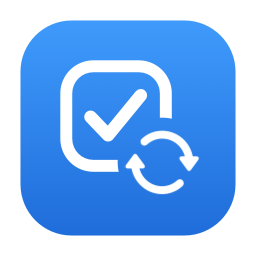
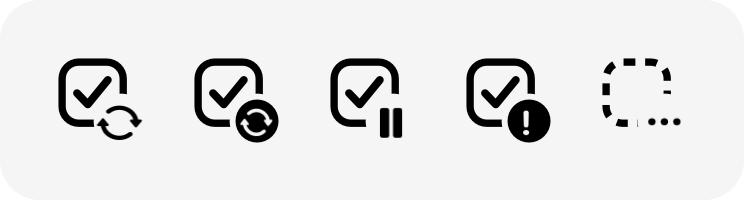

<p align="center">
  
</p>

<h1 align="center">Things Reminders Sync</h1>

<p align="center">
  <strong>Two-way sync between Apple Reminders lists and Things 3, from a native menu bar app</strong>
</p>

<p align="center">
  <code>two-way</code> &bull;
  <code>repeat rules both ways</code> &bull;
  <code>4 mapping modes</code> &bull;
  <code>no third-party dependencies</code>
</p>

<p align="center">
  <a href="https://github.com/oliverames/things-reminders-sync/releases/latest">
    
  </a>
  <a href="https://github.com/oliverames/things-reminders-sync/actions/workflows/test.yml">
    
  </a>
  <a href="LICENSE">
    
  </a>
  <a href="https://www.buymeacoffee.com/oliverames">
    
  </a>
</p>

---

Things Reminders Sync keeps the Apple Reminders lists you choose in step with Things 3, in both directions. Each list maps to a Things project, area, tag, or heading, and titles, notes, dates, completion, repeat rules, links, tags, flags and subtasks carry across. Each app keeps its own conventions, so a link stays a rich link in Reminders and a clickable line in Things.

## Why this exists

Things is where I plan, and Reminders is where everything else lands: Siri, the share sheet, a list someone else in the house can see. Things can import from Reminders, but only one way, and the import removes the reminder. I wanted the two to stay in sync for good, on lists I pick, without retyping anything.

There's no public Things API, so the app talks to Things Cloud directly, the same sync service the Things apps use. That means it works on a Mac where Things isn't even running, which is how I run it, on an always-on Mac at home. It reaches Reminders through [RemCTL](https://github.com/viticci/remctl), so the app itself never needs Reminders permission. That matters on a headless Mac, where macOS sometimes can't show a permission prompt at all.

Writing to an undocumented sync protocol is risky, and I learned that the hard way when a malformed id crashed Things for Mac. So every change is validated before it's sent, and the app only writes record shapes I've watched the real Things app produce. There's more on that below.

## Quick start

1. Install [RemCTL](https://github.com/viticci/remctl) and authorize its Capability Host for Reminders. `remctl doctor` should report `reminders: authorized`.
2. Download `ThingsRemindersSync-<version>.zip` from the [latest release](https://github.com/oliverames/things-reminders-sync/releases/latest), unzip it, and move **Things Reminders Sync** to `/Applications`. It's signed with a Developer ID and notarized by Apple.
3. Open it. It lives in the menu bar only.
4. In **Settings → Account**, sign in to Things Cloud and check that the Reminders row shows a green check.
5. In **Settings → Lists**, turn on the lists you want, pick a Things target for each, and hit **Save**.

Back up your Things data and try a test list first. I mean it.

## The menu bar icon

<p align="center">
  <picture>
    <source media="(prefers-color-scheme: dark)" srcset="docs/images/menubar-states-dark.png">
    
  </picture>
</p>

The icon is a to-do checkbox with a badge that tells you what sync is doing. From left to right, the states are up to date, syncing, paused, needs attention, and setup needed. It's drawn in code as a template image, so it follows light, dark and tinted menu bars.

## How lists map to Things

| Mode | A Reminders list becomes | Good for |
|---|---|---|
| **Project** | A Things project, and Reminders sections can mirror its headings | A list with an end, like a renovation |
| **Area** | A Things area | An ongoing list, like Personal or Family |
| **Tag** | Every to-do carrying a Things tag, wherever it's filed | A person or a context |
| **Heading** | One heading inside a Things project | Several small lists that belong in one project |

You can change a list's mode or target later. The app moves the items it linked to the new place and removes the containers it created once they're empty, so changing your mind doesn't leave leftovers in either app.

## What syncs

| Reminders | Things | Notes |
|---|---|---|
| Title | Title | |
| Notes (plain text) | Notes (Markdown) | Things keeps the Markdown, and Reminders gets a readable plain version. The Things notes change only when you edit the notes in Reminders, and that edit replaces them with the plain text, so the Markdown of that note is lost. |
| Rich link | A link on the last line of the notes | Things shows it as a clickable link. |
| Due date and time | When date and reminder time | A list can map the due date to the Things deadline instead (`dueMapsTo`), and can send reminders due this evening to This Evening (`eveningFromHour`). See the per-list settings. |
| Completed | Completed | Canceled in Things counts as completed in Reminders, unless the list's `canceledBecomes` is `deleted`. |
| Repeat rule | Repeat rule | Daily, weekly, monthly and yearly rules, including nth weekdays, the last day of the month, and end conditions. |
| Flag | Your **Important** tag | The tag name is `flaggedTagTitle` in `config.json`. Settings has no control for it yet. |
| Priority high | A tag you choose | Off until you set `priorityTag` in `config.json`. See "More options" below. |
| Tags | Tags with the same name | Only tags that already exist in Things, matched without regard to case. The app never creates a tag for this unless you turn on `createMissingTags`. The only tag it ever creates is the target of a tag-mode list you save as "New…". |
| Subtasks | Checklist items | Both ways: adding, renaming, completing or removing one changes the other. Set `syncChecklists` to `false` in `config.json` to stop writing checklists in Things. |
| Section | Heading | In project mode. |

Fields that only one app has stay put and are never cleared. That covers priority (unless you set `priorityTag`), urgent, early reminders, location alarms, images and assignees in Reminders, and deadlines (unless a list maps the due date to them) and This Evening in Things. Every update carries only the fields that changed. A due date change leaves a reminder's other alerts alone, and a new time on the same day leaves a to-do in This Evening. Moving a to-do to another day takes it out of This Evening, because This Evening belongs to today.

A reminder that is due all day and has an alert on that day shows a time in Reminders, so it syncs as due at that time.

A to-do you leave in Today keeps the day it was scheduled for, so the day after, Things still shows it under Today while Reminders shows the reminder as overdue. Both are the same date.

When a list is first turned on and an item has different notes on each side, the Things notes win and the activity log names the item.

### Repeating items

A repeating reminder pairs with a Things repeating to-do, and the rule syncs both ways. Complete it in either app and the other one moves on to the next date. Things creates the copies of a repeating to-do itself, so the app never makes them for it.

You can add a repeat to an item that is already synced. Add it in Things and the reminder gets the same rule. Add it in Reminders and the Things to-do stands for the current occurrence; when you complete it, Things gets a repeating to-do for the rule. A new time for a repeating reminder is written to the Things repeating to-do as well, so later occurrences keep it.

Stop a repeat in either app and the pair carries on as a plain item. Remove the repeat from the reminder and the app stops the Things repeating to-do the way Things does: it leaves a plain to-do with the same notes, tags and checklist, and to-dos Things already made for earlier dates stay in Things. Stop the repeat in Things and the reminder loses its rule and follows the to-do Things keeps for the next date. Pausing a repeat in Things changes nothing in Reminders.

Some rules only one app can express. Reminders has no "repeat after completion," and RemCTL can't write every rule Reminders supports. When that happens, the app syncs the current occurrence as a plain item and logs why.

## How it stays safe

- **Validated writes.** Every Things change is checked before it's sent. Ids have to decode to exactly 16 bytes, dates have to be real calendar days, references have to point at live items, and repeat rules have to match a shape on file in [docs/RECURRENCE.md](docs/RECURRENCE.md). A change that fails isn't sent.
- **A deletion limit.** If one pass would delete more than 10 items in all, or more than a quarter of one list's links, it holds those deletions and waits for you to choose **Sync Now** from the menu. One deletion in a list is never held by the quarter rule.
- **A failed read is never a deletion.** If the app can't read Reminders or Things, or can't tell which of two lists with the same name a reminder is in, the pass stops and nothing is changed. Two lists may share a name; the app tells them apart by id.
- **No blind retries.** A write to Reminders that gets no answer is never sent again. The app reads the reminder back to see whether the write landed. An item whose partner already exists is linked by title instead of being copied a second time.
- **Trash, never purge.** Deleted Things to-dos, projects and headings go to the Trash, and the app never empties it. The one exception is an area or tag the app created itself: Things has no Trash for those, so the app deletes one once nothing uses it, counting what is in the Trash as use.
- **An ownership ledger.** The app records what it created, so when you change settings it removes only its own copies and never your items.
- **Conflicts by field.** A field changed on only one side is copied to the other. When the same field changed on both sides, the later edit of that field wins, so renaming a to-do in Things and rescheduling it in Reminders keeps both. Things records when each field of a to-do last changed. RemCTL reports no modification time, so for a reminder the app uses the moment it first saw the field change. While the app is running that is accurate to the poll interval. After the Mac sleeps or the app restarts, a field edited in the meantime counts as edited when the app next looked, which is later than the real edit, so it wins over a Things edit of the same field made during the same gap.

## Configuration

Settings live in the app, apart from the flag tag name. These are the defaults:

| Setting | Default | Range | What it does |
|---|---|---|---|
| Reminders poll | 10 s | 5 to 120 s | How often the app checks Reminders for changes |
| Things poll | 15 s | 10 to 300 s | How often it checks Things Cloud for new history |
| Full reconcile | 10 min | 5 to 120 min | A complete two-way pass that catches anything a poll missed |
| Propagate deletes | On | | Deleting on one side deletes the partner |
| Include completed on first link | Off | | Whether completed items come across when a list is first turned on |

The ranges are what Settings offers. A `config.json` edited by hand is only held to a floor: 1 s for the Reminders poll, 5 s for the Things poll and 1 minute for the full reconcile.

### Per-list settings

Each list can also carry its own settings. Settings has no controls for them yet, so for now they go in that list's entry in `config.json`. Leave one out and the list behaves as it always has.

| Key | Default | What it does |
|---|---|---|
| `direction` | `twoWay` | `remindersToThings` or `thingsToReminders` makes the list one-way. The app then never writes to the side the changes come from. If you edit an item on the receiving side, the app leaves your edit alone until that same field changes on the source, and then the source's value replaces it. New items and deletions only travel from the source, so an item you create on the receiving side stays where it is, unlinked. |
| `paused` | `false` | A paused list keeps its links and the app leaves it alone. When you resume it, edits made in the meantime sync, but an item that went missing on one side isn't treated as a deletion. The pair is unlinked and the surviving item stays. |
| `propagateDeletes` | follows the global setting | `true` or `false` for this list only. |
| `undatedArriveAs` | `anytime` | Where a reminder with no due date lands in Things when its to-do is created: `anytime`, `someday` or `today`. It never moves a to-do that already exists, and a to-do that arrives in Today doesn't give the reminder a due date. |
| `alwaysTag` | none | The name of a Things tag to put on every to-do linked through this list. The tag has to exist already. The app adds it when it creates or links the to-do, never removes it, and never copies it to Reminders. A `thingsToReminders` list ignores it, because the app doesn't write to Things there. |
| `includeCompletedOnFirstLink` | follows the global setting | `true` or `false` for this list only. |
| `syncChecklists` | follows the global setting | `true` or `false` for this list only. |
| `dueMapsTo` | `when` | `deadline` makes a reminder's due date the to-do's deadline. The to-do's When is then left alone in both directions, and a new to-do starts where `undatedArriveAs` says. Changing or clearing the deadline in Things changes or clears the due date, and the other way round. A due time has no place in a deadline, so it stays in Reminders. Repeating items in the list still use the When. |
| `eveningFromHour` | none | An hour from 0 to 23. A reminder due today at or after that hour arrives in This Evening, and a linked to-do moves there when its reminder's due date changes to this evening. The app does this once per due date, so a to-do you move back to Today stays there. Nothing changes from Things to Reminders, and a date you set in Things is left where you put it. Ignored when `dueMapsTo` is `deadline`. |
| `canceledBecomes` | `completed` | `deleted` deletes the reminder when you cancel its to-do in Things, instead of completing it. It counts as a deletion: it respects `propagateDeletes` and the deletion safety limit, and a list that is one-way from Reminders ignores it. A to-do you only complete still completes the reminder. |
| `syncSomeday` | `true` | `false` keeps Someday out of Reminders. A to-do in Someday gets no reminder. A linked to-do you move to Someday has its reminder deleted (again respecting `propagateDeletes` and the safety limit), and when it leaves Someday the reminder is made again. A reminder is still copied to Things as before, including one that arrives in Someday. |

### More options

These apply to every list and also go in `config.json`.

| Key | Default | What it does |
|---|---|---|
| `priorityTag` | none | The name of a Things tag that stands for priority high, the way `flaggedTagTitle` stands for the flag. A high-priority reminder gets the tag, and a to-do with the tag makes its reminder high priority. Taking the tag off sets the priority to none. Low and medium are never synced, and lowering a reminder from high only removes the tag. The tag has to exist already, and it can't be the same tag as `flaggedTagTitle`. |
| `createMissingTags` | `false` | When `true`, a reminder tag that Things has no tag for is created in Things and then synced. The app remembers that it made the tag, and removes it again once nothing uses it. It never creates the tags named by `alwaysTag`, `flaggedTagTitle` or `priorityTag`. |

Your Things Cloud password is stored in the macOS Keychain.

## Requirements

- macOS 26 or later
- A Things Cloud account
- [RemCTL](https://github.com/viticci/remctl) installed at `~/bin/remctl`, `/opt/homebrew/bin/remctl` or `/usr/local/bin/remctl`, or set its path in Settings

## Building from source

```bash
swift test                       # unit tests: fakes only, no network, Keychain or real reminders
scripts/build-app.sh release     # assembles .build/ThingsRemindersSync.app
```

Set `SIGN_IDENTITY` to your own `Developer ID Application: ...` identity and `BUNDLE_ID` to your own bundle id. Without an identity, the app is signed ad hoc. `scripts/release.sh` builds, notarizes, staples and zips a release.

```text
Sources/
  SyncCore/
    Engine/        the sync engine: links, merge rules, repeats, field fidelity, teardown
    ThingsCloud/   Things Cloud client, change builder and the write validator
    Reminders/     the RemCTL backend
    App/           coordinator, state store, Keychain
  ThingsRemindersSync/   the menu bar app (SwiftUI)
  trs-admin/             maintenance CLI, including a dry run that prints every write without sending it
docs/
  SPEC.md          behavior and protocol notes
  RECURRENCE.md    repeat-rule shapes observed from the real apps
```

## Disclaimer

This project isn't affiliated with or endorsed by Cultured Code or Apple. Things Cloud has no public API, and its protocol can change without notice. Use it at your own risk, keep backups, and start with a test list.

## Contributing

Forks and pull requests are welcome. Before you teach the app a new Things Cloud field, record the exact shape the Things app writes for it and add it to the docs with the code. That rule is what keeps this app from crashing anyone's Things.

## License

MIT. See [LICENSE](LICENSE).

---

<p align="center">
  <a href="https://www.buymeacoffee.com/oliverames">
    
  </a>
</p>

<p align="center">
  <sub>
    Built by <a href="https://ames.consulting">Oliver Ames</a> in Vermont
    &bull; <a href="https://github.com/oliverames">GitHub</a>
    &bull; <a href="https://linkedin.com/in/oliverames">LinkedIn</a>
    &bull; <a href="https://bsky.app/profile/oliverames.bsky.social">Bluesky</a>
  </sub>
</p>
